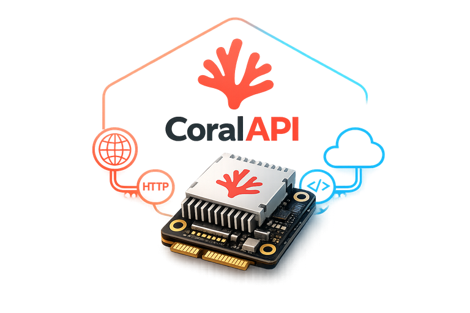

# CoralAPI

[](https://github.com/nathan-v/coralapi/blob/main/LICENSE)
[](https://www.python.org/downloads/)
[](https://github.com/nathan-v/coralapi/actions/workflows/ci.yml)
[](https://github.com/nathan-v/coralapi/releases)
[](https://github.com/nathan-v/coralapi/commits/main)



A FastAPI service that exposes HTTP inference APIs for Google Coral Edge TPUs (PCIe/M.2 and USB). Point it at a Coral, POST an image, get a result — classification, detection, segmentation, pose, embeddings, or the raw output tensors of any `.tflite` model. Deployable as a Docker container locally or on Kubernetes.

It aims to be the well-supported, modern replacement for aging Coral inference servers (e.g. CodeProject.AI's Coral path): current Python, a clean REST API, per-request model selection with automatic downloads, and honest handling of the finicky Coral runtime stack.

> **A Coral TPU is required.** There is no CPU fallback — the service fails fast at startup with an actionable error if no Edge TPU is available, so a running instance always means accelerated inference.

## Contents

- [Features](#features)
- [Quickstart](#quickstart)
- [Endpoints & examples](#endpoints--examples)
- [Python client](#python-client)
- [Models](#models)
- [Configuration](#configuration)
- [Build profiles (CPU / architecture)](#build-profiles-cpu--architecture)
- [Monitoring](#monitoring)
- [Security model](#security-model)
- [Kubernetes](#kubernetes)
- [How it works](#how-it-works)
- [Troubleshooting](#troubleshooting)
- [Development](#development)
- [License](#license)

## Features

- **Six task endpoints + a generic escape hatch** — classification, object detection (SSD **and** YOLO), semantic segmentation, pose estimation, and image embeddings each decode server-side; `POST /v1/raw/infer` runs *any* model and returns its output tensors for client-side decoding.
- **Per-request model selection** — pass `model=<name>`; a model that isn't present locally is downloaded from the configured source (default: the [Coral model zoo test data](https://github.com/google-coral/test_data)) and cached.
- **Sync and async** — call an endpoint and wait, or submit to `/v1/jobs/*` and poll a job id.
- **Bounded TPU queue** — the TPU runs one inference at a time; concurrent requests queue up to `CORALAPI_QUEUE_DEPTH`, then return `429`.
- **Safe uploads** — request bodies stream to disk (never buffered in memory), with configurable size (default 500 MB) and resolution (default 16K) limits enforced before the body is read.
- **Optional Prometheus metrics** at `/metrics`.
- **Modern & maintainable** — built on `tflite-runtime` + the `libedgetpu` delegate (not the unmaintained, Python-3.9-capped `pycoral`), with build profiles for AVX2, non-AVX2, and ARM CPUs.

## Quickstart

### Docker

```sh
docker build -t coralapi .                 # AVX2 x86-64 host; see "Build profiles" for others

# PCIe / M.2 module (needs the gasket/apex driver on the host):
docker run --device /dev/apex_0 -p 8000:8000 -v ./models:/models coralapi

# USB Accelerator:
docker run --device /dev/bus/usb -p 8000:8000 -v ./models:/models coralapi
```

Classify an image — the model downloads on first use:

```sh
curl -F file=@cat.jpg \
  "http://localhost:8000/v1/vision/classify?model=tf2_mobilenet_v2_1.0_224_ptq_edgetpu"
```

Interactive, always-current API docs are served at **<http://localhost:8000/docs>** (Swagger UI) and `/redoc`; the raw schema is at `/openapi.json`.

### From source

Requires [uv](https://docs.astral.sh/uv/) and an attached Coral (the service won't start without one):

```sh
git clone https://github.com/nathan-v/coralapi.git && cd coralapi
uv sync
CORALAPI_MODEL_DIR=./models uv run uvicorn coralapi.main:app --host 0.0.0.0 --port 8000
```

> Installing `tflite-runtime` + `libedgetpu` from PyPI/apt on your own host is version-sensitive — see [Build profiles](#build-profiles-cpu--architecture) and [Troubleshooting](#troubleshooting). The Docker image bundles a known-good, matched runtime, which is the recommended way to run.

## Endpoints & examples

| Endpoint | Purpose |
|---|---|
| `POST /v1/vision/classify?model=<name>` | Classify an image → ranked labels |
| `POST /v1/vision/detect?model=<name>` | Object detection → boxes + labels |
| `POST /v1/vision/segment?model=<name>` | Semantic segmentation → class mask (PNG) + summary |
| `POST /v1/vision/pose?model=<name>` | Single-pose keypoints → named (x, y, score) |
| `POST /v1/vision/embed?model=<name>` | Image embedding → feature vector |
| `POST /v1/raw/infer?model=<name>` | Any model → raw output tensors |
| `POST /v1/jobs/classify`, `.../detect` | Submit async job → `202` + job id |
| `GET /v1/jobs/{id}` | Poll async job status/result |
| `GET /v1/models` | List locally available models |
| `GET /v1/status` | TPU runtime + discovered hardware |
| `GET /v1/queue` | Queue depth + pending count |
| `POST /v1/reset` | Rebind the Edge TPU after a device replug (no restart) |
| `GET /metrics` | Prometheus metrics (when enabled) |
| `GET /healthz` | Liveness probe — process is up (unversioned) |
| `GET /readyz` | Readiness probe — the bound TPU is present & unchanged (unversioned) |

Every endpoint takes the image as a multipart `file` field and the model as a `model` query parameter. Results are JSON. Below is a worked request + response for each.

### Classification

```sh
curl -F file=@cat.jpg \
  "http://localhost:8000/v1/vision/classify?model=tf2_mobilenet_v2_1.0_224_ptq_edgetpu&top_k=3"
```
```json
{
  "model": "tf2_mobilenet_v2_1.0_224_ptq_edgetpu",
  "results": [
    {"index": 286, "label": "Egyptian cat", "score": 0.68},
    {"index": 283, "label": "tabby",        "score": 0.12},
    {"index": 282, "label": "tiger cat",    "score": 0.07}
  ]
}
```
`top_k` (default 5) caps the number of classes returned. `label` is `null` unless a labels file is present (see [Models](#models)).

### Object detection

```sh
curl -F file=@street.jpg \
  "http://localhost:8000/v1/vision/detect?model=ssd_mobilenet_v2_coco_quant_postprocess_edgetpu&threshold=0.4"
```
```json
{
  "model": "ssd_mobilenet_v2_coco_quant_postprocess_edgetpu",
  "results": [
    {"box": [0.11, 0.09, 0.98, 0.76], "index": 16, "label": "cat", "score": 0.95}
  ]
}
```
`box` is `[ymin, xmin, ymax, xmax]` normalized to 0..1 (the TFLite convention). `threshold` (default 0.4) filters low-confidence detections. Works with SSD and YOLO models (see [Models](#models)).

### Semantic segmentation

```sh
curl -F file=@street.jpg \
  "http://localhost:8000/v1/vision/segment?model=deeplabv3_mnv2_pascal_quant_edgetpu"
```
```json
{
  "model": "deeplabv3_mnv2_pascal_quant_edgetpu",
  "width": 513, "height": 513,
  "classes": [
    {"index": 0,  "label": "background", "pixels": 178956},
    {"index": 15, "label": "person",     "pixels": 84213}
  ],
  "mask_png": "iVBORw0KGgoAAAANS…"
}
```
`mask_png` is a base64 PNG (mode `L`) where each pixel's value is its class index — decode and reshape client-side (see the [Python client](#python-client)). `classes` lists the classes present, most pixels first.

### Pose estimation

```sh
curl -F file=@person.jpg \
  "http://localhost:8000/v1/vision/pose?model=movenet_single_pose_lightning_ptq_edgetpu"
```
```json
{
  "model": "movenet_single_pose_lightning_ptq_edgetpu",
  "keypoints": [
    {"name": "nose",          "x": 0.51, "y": 0.22, "score": 0.94},
    {"name": "left_eye",      "x": 0.53, "y": 0.20, "score": 0.91},
    {"name": "left_shoulder", "x": 0.60, "y": 0.38, "score": 0.88}
  ]
}
```
`x`/`y` are normalized 0..1. 17-keypoint models are named in COCO order (`nose`, `left_eye`, …); other counts are named `kp0`, `kp1`, …

### Image embeddings

```sh
curl -F file=@product.jpg \
  "http://localhost:8000/v1/vision/embed?model=mobilenet_v1_1.0_224_quant_embedding_extractor_edgetpu&normalize=true"
```
```json
{ "model": "…", "dimension": 1024, "normalized": true, "embedding": [0.031, -0.007, 0.052] }
```
The feature vector, for similarity search, deduplication, or on-device imprinting. `normalize=true` L2-normalizes it, so cosine similarity is a plain dot product.

### Generic / raw inference (any model)

For any model CoralAPI has no dedicated decoder for, `POST /v1/raw/infer` runs it and returns every output tensor verbatim, for you to decode:

```sh
curl -F file=@input.jpg \
  "http://localhost:8000/v1/raw/infer?model=your_custom_model_edgetpu"
```
```json
{
  "model": "your_custom_model_edgetpu",
  "input_shape": [1, 224, 224, 3],
  "outputs": [
    {
      "name": "output0",
      "shape": [1, 1001],
      "dtype": "float32",
      "quantization": {"scale": 0.00390625, "zero_point": 0},
      "data": [0.001, 0.004, "…"]
    }
  ]
}
```
`data` is flattened in row-major (C) order; reshape with `shape`. Integer outputs are dequantized to `float32` by default; pass `?dequantize=false` for raw quantized values plus `scale`/`zero_point`. Decoding hints for common model types:

| Model type | Output shape | Decode (`arr = np.array(out["data"]).reshape(out["shape"])`) |
|---|---|---|
| Segmentation | `[1, H, W]` or `[1, H, W, C]` | `arr[0]` (or `arr[0].argmax(-1)` for per-class logits) |
| Pose | `[1, 1, 17, 3]` | `arr[0, 0]` → 17 `(y, x, score)` keypoints |
| Embeddings | `[1, D]` | `arr[0]` is the vector |

### Async jobs

For long-running or fire-and-forget calls, submit a job and poll it. Jobs share the same TPU queue as synchronous requests.

```sh
# Submit → 202 Accepted with a job id
curl -F file=@cat.jpg \
  "http://localhost:8000/v1/jobs/detect?model=ssd_mobilenet_v2_coco_quant_postprocess_edgetpu"
# {"id":"9f2c…","kind":"detect","model":"…","status":"queued","created_at":1.7e9,"finished_at":null,"error":null,"result":null}

# Poll until status is "succeeded" or "failed"
curl "http://localhost:8000/v1/jobs/9f2c…"
# {"id":"9f2c…","status":"succeeded","result":{"model":"…","results":[{"box":[…],"index":16,"label":"cat","score":0.95}]}, …}
```
Job results are kept in memory for `CORALAPI_JOB_RETENTION_SECONDS` (default 1h), then purged. Job state is per-replica — with multiple replicas, poll on the replica that accepted the job (use session affinity).

### Errors

Errors are JSON `{"detail": "…"}` with a status code, and are deliberately generic (internal detail is logged server-side, not returned):

| Status | Meaning |
|---|---|
| `400` | Uploaded file is not a decodable image |
| `404` | Unknown model (not local and not downloadable) |
| `413` | Upload exceeds the size or resolution limit |
| `429` | TPU queue is full — retry later |
| `502` | Model download from the source failed |
| `503` | Inference runtime unavailable |

## Python client

A runnable client with a helper per endpoint (including mask/keypoint decoding) lives at [`examples/client.py`](examples/client.py):

```python
from examples.client import CoralAPI

api = CoralAPI("http://localhost:8000")

print(api.classify("cat.jpg", "tf2_mobilenet_v2_1.0_224_ptq_edgetpu", top_k=3))
print(api.detect("street.jpg", "ssd_mobilenet_v2_coco_quant_postprocess_edgetpu"))

mask = api.segment_mask("street.jpg", "deeplabv3_mnv2_pascal_quant_edgetpu")  # -> (H, W) numpy array
vec = api.embed("product.jpg", "mobilenet_v1_1.0_224_quant_embedding_extractor_edgetpu", normalize=True)
```

Run it directly against a live server: `python examples/client.py http://localhost:8000 cat.jpg`.

## Models

Any Edge TPU-compiled `.tflite` model works — drop it in the model directory (`CORALAPI_MODEL_DIR`) or let the service download it by name on first use. Classification, detection, segmentation, pose, and embeddings have dedicated decoders; anything else runs through [`/v1/raw/infer`](#generic--raw-inference-any-model).

**Model selection & download.** The `model` parameter is a file stem (no `.tflite`). If `<name>.tflite` isn't in the model directory, it's fetched from `CORALAPI_MODEL_SOURCE/<name>.tflite` (HTTPS only, no redirects), cached, and reused. Set `CORALAPI_MODEL_DOWNLOAD=false` to serve only local models.

**Labels.** For recognized zoo models the correct shared label file — `coco_labels.txt`, `imagenet_labels.txt`, `inat_bird_labels.txt`, PASCAL segmentation, etc. — is **auto-fetched alongside the model** (guessed from the model name), so `label` is populated with no setup. Precedence: a per-model `<name>.labels.txt` (or `<name>.txt`) you supply wins over the guess; a shared `labels.txt` is the final fallback. For a custom model CoralAPI can't recognize, drop a `<name>.labels.txt` in the model directory — otherwise results still return with `label: null` (and models like face/pose/embeddings have no class labels by design).

### Known-working models (as of July 2026)

Verified present in the default source ([google-coral/test_data](https://github.com/google-coral/test_data)) — pass the name without `.tflite`; it downloads on first use.

**Classification** (`/v1/vision/classify`, labels: `imagenet_labels.txt` unless noted):

- `mobilenet_v1_1.0_224_quant_edgetpu` (also `0.25_128`, `0.5_160`, `0.75_192`)
- `mobilenet_v2_1.0_224_quant_edgetpu`
- `mobilenet_v2_1.0_224_inat_bird_quant_edgetpu` (labels: `inat_bird_labels.txt`; also `_inat_insect_`, `_inat_plant_`)
- `tf2_mobilenet_v1_1.0_224_ptq_edgetpu`, `tf2_mobilenet_v2_1.0_224_ptq_edgetpu`, `tf2_mobilenet_v3_edgetpu_1.0_224_ptq_edgetpu`
- `efficientnet-edgetpu-S_quant_edgetpu`, `-M_`, `-L_`
- `inception_v1_224_quant_edgetpu` through `inception_v4_299_quant_edgetpu`
- `tfhub_tf2_resnet_50_imagenet_ptq_edgetpu`

**Object detection** (`/v1/vision/detect`, labels: `coco_labels.txt` unless noted — use the `_postprocess`/`_ptq` variants that include the NMS postprocess; `_no_nms` variants are not supported):

- `ssd_mobilenet_v1_coco_quant_postprocess_edgetpu`, `ssd_mobilenet_v2_coco_quant_postprocess_edgetpu`
- `ssdlite_mobiledet_coco_qat_postprocess_edgetpu`
- `efficientdet_lite0_320_ptq_edgetpu` through `efficientdet_lite3x_640_ptq_edgetpu`
- `tf2_ssd_mobilenet_v2_coco17_ptq_edgetpu`, `tf2_ssd_mobilenet_v1_fpn_640x640_coco17_ptq_edgetpu`
- `ssd_mobilenet_v2_face_quant_postprocess_edgetpu` (face detection; no labels needed)

The detection decoder auto-detects the postprocess output order, so both the TF1 `(boxes, classes, scores, count)` layout and the TF2 Object Detection API's reversed `(boxes, scores, classes, count)` layout decode correctly.

**Segmentation** (`/v1/vision/segment`): `deeplabv3_mnv2_pascal_quant_edgetpu`, `deeplabv3_mnv2_dm05_pascal_quant_edgetpu`, `keras_post_training_unet_mv2_128/256_quant_edgetpu`.

**Pose** (`/v1/vision/pose`): `movenet_single_pose_lightning_ptq_edgetpu`, `movenet_single_pose_thunder_ptq_edgetpu`.

**Embeddings** (`/v1/vision/embed`): the `*_embedding_extractor_edgetpu` models and `tfhub_tf2_resnet_50_imagenet_ptq_edgetpu`.

### YOLO

Ultralytics YOLO models (v8/11/26) run on Coral via their [Edge TPU export](https://docs.ultralytics.com/integrations/edge-tpu):

```sh
yolo export model=yolo11n.pt format=edgetpu   # → yolo11n_full_integer_quant_edgetpu.tflite
```

The raw YOLO head (no built-in NMS) is decoded server-side, so the export works with `/v1/vision/detect` as-is. YOLO exports aren't in the default source — drop the file into the model directory alongside an 80-class COCO `<model>.labels.txt`.

## Configuration

All settings are environment variables prefixed `CORALAPI_`:

| Variable | Default | Meaning |
|---|---|---|
| `CORALAPI_MODEL_DIR` | `/models` | Directory scanned for `*.tflite` models |
| `CORALAPI_DEVICE` | `auto` | Which Edge TPU: `auto`, `usb`, `pci`, or a specific index (`pci:0`, `pci:1`, `usb:0`) to pin one instance to one TPU — see [Multiple TPUs](#multiple-tpus) |
| `CORALAPI_MODEL_SOURCE` | Coral test_data mirror | Base URL for model downloads (must be `https`) |
| `CORALAPI_MODEL_DOWNLOAD` | `true` | Disable to serve only local models |
| `CORALAPI_ALLOW_INSECURE_MODEL_SOURCE` | `false` | Permit a non-HTTPS `model_source` (not recommended) |
| `CORALAPI_MAX_DOWNLOADED_MODELS` | `100` | Cap on models cached to disk via download (count) |
| `CORALAPI_MAX_MODEL_BYTES` | `268435456` (256 MB) | Per-model download size cap; an over-size download is aborted |
| `CORALAPI_MAX_MODEL_CACHE_BYTES` | `4294967296` (4 GB) | Total model-cache size cap; a download over it is refused |
| `CORALAPI_MODEL_CHECKSUMS` | `{}` | Optional JSON `{name: sha256}`; a listed model's download is verified |
| `CORALAPI_QUEUE_DEPTH` | `16` | Requests allowed to wait for the TPU (else `429`) |
| `CORALAPI_JOB_RETENTION_SECONDS` | `3600` | How long finished async job results are pollable |
| `CORALAPI_MAX_UPLOAD_BYTES` | `524288000` (500 MB) | Request-body size limit (`413` beyond; enforced at the ASGI layer) |
| `CORALAPI_UPLOAD_DIR` | `<tmp>/coralapi-uploads` | Directory streamed uploads are written to |
| `CORALAPI_MAX_IMAGE_DIM` | `15360` (16K) | Longest allowed image edge in pixels |
| `CORALAPI_ALLOWED_IMAGE_FORMATS` | `[]` (any) | Optional JSON list of decoded formats to accept (e.g. `["JPEG","PNG"]`); others get `415` |
| `CORALAPI_MAX_VIDEO_DIM` | `15360` (16K) | Reserved for the planned video endpoints |
| `CORALAPI_EDGETPU_LIB` | unset | Override the libedgetpu shared-library path |
| `CORALAPI_METRICS_ENABLED` | `false` | Expose Prometheus metrics at `/metrics` |

## Build profiles (CPU / architecture)

`libedgetpu` and `tflite_runtime` must be built against compatible TFLite versions, and prebuilt tflite wheels target a CPU instruction set — an **AVX2 wheel crashes (SIGILL) on a pre-Haswell CPU**. Pick a profile for your target by overriding two build args (current URLs are in the `Dockerfile` header):

| Profile | Target | Build |
|---|---|---|
| **avx2** (default) | x86-64 with AVX2 (Intel Haswell / 2013+, most modern CPUs) | `docker build -t coralapi .` |
| **compat** | x86-64 **without** AVX2 (e.g. Sandy/Ivy Bridge Xeon) | `--build-arg TFLITE_SPEC=tflite-runtime==2.14.0 --build-arg LIBEDGETPU_DEB=<feranick 2.13.1 std .deb> --build-arg LIBEDGETPU_SHA256=4ffb6c2251b61535afb6b368d821211a914d2d4783770ec7e6001c073c2d193b` |
| **arm** | Raspberry Pi (armhf) | `--platform linux/arm/v7` plus the armhf `LIBEDGETPU_DEB` and armv7l `TFLITE_SPEC` wheel, each with its matching `LIBEDGETPU_SHA256` / `TFLITE_SHA256` |

Not sure whether your CPU has AVX2? Run `grep -o avx2 /proc/cpuinfo` — no output means use **compat**.

Whenever you override `LIBEDGETPU_DEB` or point `TFLITE_SPEC` at a wheel URL, also pass the matching `LIBEDGETPU_SHA256` / `TFLITE_SHA256` (get it with `sha256sum`). The build verifies every downloaded artifact against the pinned checksum and fails on a mismatch, so a stale default checksum stops the build rather than silently installing the wrong binary.

The default (avx2) uses the [feranick](https://github.com/feranick/libedgetpu) matched pair (libedgetpu + tflite_runtime at the same TF version — the reliable pairing rule, since no formal compatibility matrix is published). The **compat** profile pairs Google's PyPI `tflite-runtime` 2.14.0 (built without AVX2) with feranick's nearest libedgetpu (2.13.1) — verified working end-to-end on a no-AVX2 Xeon. See [Troubleshooting](#troubleshooting) if inference fails.

## Monitoring

Set `CORALAPI_METRICS_ENABLED=true` to expose Prometheus metrics at `GET /metrics` (the image bundles `prometheus-client`; for a source install add the `prometheus` extra). Alongside the default process/Python collectors:

| Metric | Type | Labels |
|---|---|---|
| `coralapi_inferences_total` | counter | `operation`, `model`, `status` (`ok` or the HTTP status) |
| `coralapi_inference_duration_seconds` | histogram | `operation`, `model` (successful requests) |
| `coralapi_queue_pending` | gauge | — (running or waiting for the TPU) |
| `coralapi_queue_depth` | gauge | — (configured limit) |
| `coralapi_models_loaded` | gauge | — (models held on the TPU) |

`/metrics` is unauthenticated like the rest of the API — scrape it from within the cluster, behind the gateway.

## Security model

The service ships **without authentication or rate limiting** — deploy it behind an authenticated gateway/ingress and add per-client rate limiting there. Given that posture, it still bounds unauthenticated resource use and avoids leaking internals:

- **Upload flooding** is capped at the ASGI layer: an over-limit `Content-Length` is rejected before any body is read, and a chunked body is aborted once it passes the limit — a body never fills the disk regardless of what the client declares.
- **Model downloads** run server-side against `CORALAPI_MODEL_SOURCE`: HTTPS-only, redirects not followed (no SSRF pivot), and model names allowlist-validated against path traversal. Disk use is bounded three ways — a per-model byte cap (`CORALAPI_MAX_MODEL_BYTES`, enforced against the declared `Content-Length` and again as a running total so a lying server can't overshoot), a total-cache byte cap (`CORALAPI_MAX_MODEL_CACHE_BYTES`), and a model count cap (`CORALAPI_MAX_DOWNLOADED_MODELS`). Auto-fetched label sidecars carry their own tight cap.
- **Model integrity** is pinnable: list a model's sha256 in `CORALAPI_MODEL_CHECKSUMS` and a download whose hash doesn't match is deleted and rejected rather than served.
- **Decoded-image formats** can be restricted with `CORALAPI_ALLOWED_IMAGE_FORMATS` to shrink the Pillow attack surface; uploads still get full PIL content validation regardless.
- **Internal paths are not disclosed**: `/v1/models` returns model filenames (not absolute server paths), and `/readyz`, `/v1/status`, and the reset response report device counts rather than sysfs paths.
- **Error responses are generic**; download URLs, filesystem paths, and library errors are logged server-side, never returned to clients (this includes async `job.error` and the `/v1/reset` failure path).
- **Supply chain**: the container build pins the `uv` image by version and verifies every downloaded `libedgetpu`/`tflite` artifact against a sha256 checksum, failing the build on mismatch. The K8s manifests cap both the uploads and models volumes with `sizeLimit` to back the application-layer byte caps.
- **Async job IDs are unguessable** (UUID4) but have no per-caller ownership — anyone with a job id can read its result. Treat job ids as bearer secrets; the gateway is the trust boundary.
- **The container runs as a non-root user**; the Kubernetes manifest sets `runAsNonRoot`, a read-only root filesystem, drops all capabilities, and prefers a device plugin over a privileged pod.

To report a vulnerability, see [SECURITY.md](SECURITY.md).

## Kubernetes

See [`deploy/k8s/deployment.yaml`](deploy/k8s/deployment.yaml). The pod needs the TPU device node — the manifest assumes a device plugin (e.g. [generic-device-plugin](https://github.com/squat/generic-device-plugin)) exposing `/dev/apex_0` as `squat.ai/apex`; a privileged `hostPath` fallback is included commented out. The TPU device node must be group-accessible to the non-root runtime user (`supplementalGroups`). Scale replicas with the number of TPUs (one inference in flight per TPU); async job state is in-memory, so use session affinity when scaling out.

## Multiple TPUs

The engine drives one TPU at a time (one dedicated thread, thread-affine delegates), so to use several Coral TPUs on one host — e.g. a **dual-PCIe card** — run **one instance per TPU**, each pinned to a specific device with `CORALAPI_DEVICE`:

```sh
docker run --device /dev/apex_0 -e CORALAPI_DEVICE=pci:0 -p 8000:8000 -v ./models:/models coralapi
docker run --device /dev/apex_1 -e CORALAPI_DEVICE=pci:1 -p 8001:8000 -v ./models:/models coralapi
```

On Kubernetes, run one replica per TPU — each with a different `CORALAPI_DEVICE` and its device assigned by the device plugin — behind a single Service for round-robin load balancing. This gives N× throughput using the proven single-TPU path per pod. (Driving multiple TPUs from a *single* process is a possible future enhancement; the current recommendation is one instance per TPU.)

## How it works

A request flows through a fixed pipeline:

1. **Upload** — the multipart body streams to a temp file in bounded chunks (never fully in memory); the size limit is enforced at the ASGI layer before the body is read, and the image's dimensions are validated from its header before any pixels are decoded.
2. **Queue** — the work is submitted to the **TPU executor**, a single dedicated worker thread. The Edge TPU runs one inference at a time, and libedgetpu delegates are thread-affine, so *all* TPU work — model loading and every inference — happens on that one thread. Requests beyond `CORALAPI_QUEUE_DEPTH` waiting are rejected with `429`.
3. **Model load** — `registry.get(name)` returns a cached, loaded model, or downloads (`<source>/<name>.tflite`) and loads it on first use. Each model gets its own Edge TPU delegate.
4. **Inference + decode** — the image is resized to the model's input tensor, the interpreter runs, and a task-specific decoder (classify/detect/segment/pose/embed) or the raw tensor dump shapes the JSON response.

**Startup** loads the Edge TPU delegate once to verify a working TPU is present — if not, the process exits with an actionable error (no CPU fallback by design). **Sync** endpoints wait for the result; **async** job endpoints reserve a queue slot immediately (so a full queue is rejected at submit time) and run the work in the background for polling.

**Device binding & recovery.** The delegate is bound to a specific device at startup, so an unplug/replug leaves it stale. `/readyz` records the device present at bind time and returns `503` if the device is later missing or re-enumerated (so Kubernetes pulls the pod from the Service), while `/healthz` (liveness) stays up so a transient replug doesn't kill the pod. `POST /v1/reset` rebinds without restarting: on the TPU thread it drops the loaded models (releasing their stale delegates) and re-acquires the device, so the next inference runs fresh.

Adding a new task type is small and uniform: a decoder method on the model + a response schema + a thin endpoint reusing the shared pipeline.

## Troubleshooting

Most issues are the Coral runtime stack, not the API. The service's `GET /v1/status` reports the interpreter in use and the hardware it discovered — check it first.

| Symptom | Cause & fix |
|---|---|
| Startup: **`RuntimeError: Coral Edge TPU unavailable … Hardware discovered: none`** | No TPU reached the process. Confirm the device is attached and passed through (`--device /dev/apex_0` for PCIe, `--device /dev/bus/usb` for USB); for a non-root container the device node must be group-accessible (`--group-add`, or `supplementalGroups` in K8s). |
| Container exits with code **132** | **SIGILL** — an AVX2-compiled tflite wheel on a CPU without AVX2. Rebuild with the **compat** [build profile](#build-profiles-cpu--architecture). |
| Inference 500s; logs show **`EdgeTpuDelegateForCustomOp failed to invoke`** | `libedgetpu` and `tflite_runtime` were built against incompatible TFLite versions. Use a matched pair (the Docker profiles do this); don't mix, e.g., Google's apt `libedgetpu` with a modern `tflite-runtime`. |
| Logs show **`numpy.core.multiarray failed to import`** | `tflite-runtime`'s C extension needs numpy 1.x; numpy 2.x breaks it. The image pins `numpy<2` — if you hit this in a source install, pin it yourself. |
| **`404 Unknown model`** | The `model` name is wrong, or it isn't in `CORALAPI_MODEL_SOURCE` and isn't a local file. Check `GET /v1/models` and the name (no `.tflite`). |
| **`502`** model download failed | The server couldn't reach `CORALAPI_MODEL_SOURCE` (no egress, or the file 404s upstream). Check network egress from the container. |
| **`429` queue full** | Too many concurrent requests for one TPU. Raise `CORALAPI_QUEUE_DEPTH`, add TPUs/replicas, or slow the caller. |
| Results have **`"label": null`** | No labels file for the model. Add `<model>.labels.txt` (or a shared `labels.txt`) to the model directory — see [Models](#models). |
| USB Coral stops being found after re-plugging | The USB Accelerator re-enumerates with a new address after an unplug/replug, leaving the loaded delegate stale. Pass the whole bus (`--device /dev/bus/usb`), not a single device path. `/readyz` returns `503` while the device is gone or changed; **`POST /v1/reset`** rebinds it without restarting the process (or just restart the pod). |

## Development

```sh
uv sync                     # install all dependencies (dev group included)
uv run pytest               # hardware-independent test suite (the TPU delegate is mocked)
uv run ruff check .         # lint
uv run ruff format .        # format
uv run uvicorn coralapi.main:app --reload   # run locally — needs a TPU attached
```

The test suite mocks the Edge TPU, so it runs anywhere (no Coral or `libedgetpu` needed) and is what CI runs. See [CONTRIBUTING.md](CONTRIBUTING.md) for the workflow.

## License

MIT — see [LICENSE](LICENSE).
